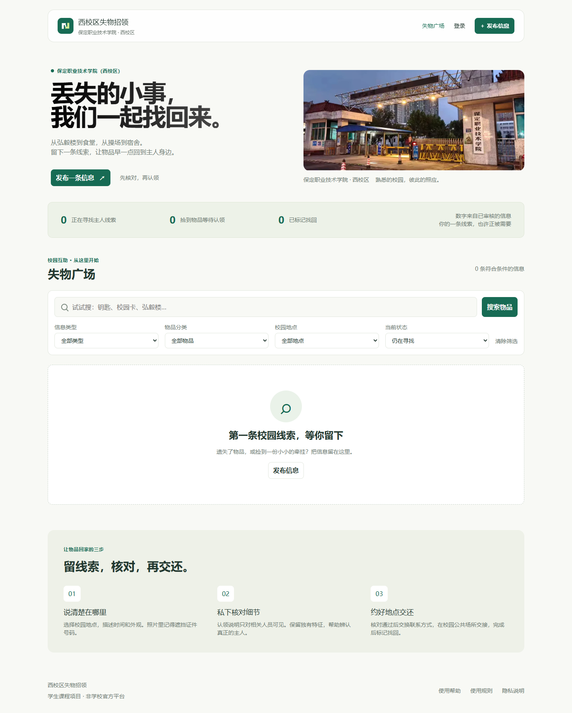

# 西校区失物招领

面向**保定职业技术学院（西校区）**的学生课程项目。用 Python、HTML、CSS、JavaScript 完成校园寻物、拾物发布、审核与认领；支持 SQLite 和 MySQL。

> 学生课程项目，非学校官方平台。源码发布到 GitHub 不等于网站已经上线。

代码采用 [MIT 开源许可证](LICENSE)，可用于学习和改进。用户数据库、物品上传照片和真实配置不属于开源内容，不进入仓库。首页校门照片由项目发起者提供用于展示，不属于代码的 MIT 授权范围。项目直接用于真实发布与认领，不生成虚构样例；新安装时信息列表与统计为零。



## 已实现

- 手机和电脑页面，西校区正门照片、关键词、物品类型、地点、状态筛选，以及分页。
- 昵称注册、密码哈希、登录、退出、自助修改密码；密码变更后其他设备重新登录。
- 寻物 / 招领信息发布与修改，13 个校园地点和位置补充；物品描述仅要求非空，不设固定字数限制。
- 图片真实格式检查、缩放和重新编码，审核前图片不公开。
- 管理员审核、退回原因；用户查看审核状态、撤下信息。
- 私下提交线索、核对认领、交换联系方式、实际交接后确认找回；可取消申请与交接。
- 我的发布、收到的申请、提交的申请分别分页，旧记录可继续翻页查看。
- 表单 CSRF 校验、参数化查询、自动转义、频率和上传大小限制。
- PythonAnywhere WSGI 入口、部署说明、业务回归测试。

## 本地快速体验

Windows 在项目目录打开 PowerShell：

```powershell
powershell -ExecutionPolicy Bypass -File .\启动项目.ps1
```

或者手动启动：

```powershell
python -m venv .venv
.\.venv\Scripts\python.exe -m pip install -r requirements.txt
.\.venv\Scripts\python.exe 启动项目.py
```

浏览器访问 `http://127.0.0.1:5000`。新安装的数据为空，同学可以注册并发布真实信息，管理员审核后公开展示。

创建正式本地环境的管理员：

```powershell
.\.venv\Scripts\python.exe -m flask --app app init-db
.\.venv\Scripts\python.exe -m flask --app app create-admin
```

没有默认账号或管理员密码，首次使用必须自行创建管理员。注册的普通账号没有审核权限。

## 校园地点

弘毅楼、笃学楼、操场、篮球场、皮克球场、乒乓球场、男二宿舍、女二宿舍、基态公寓、大食堂、小食堂、澡堂、双创基地（校外宿舍）。

继续添加地点：编辑 [校园设置.json](校园设置.json)，在“校园地点”数组追加名称，保存后重启本地程序或 Reload PythonAnywhere 网站。不会删除原有记录。

## 使用与维护

- [PythonAnywhere 部署与日常维护](使用与部署说明.md)
- [数据库结构与课程答辩说明](数据库设计.md)
- [版本记录](更新记录.md)

以后每次修改后执行：

```powershell
.\同步到GitHub.ps1 -说明 '新增图书馆地点筛选'
```

这会保存并推送一次 Git 提交。GitHub 的 **Commits** 页面可查看时间，点击某次提交可逐行查看修改。未提交的每一次键盘输入不会自动进入版本历史。网站是否更新取决于服务器是否拉取代码并 Reload。

## 验证

```powershell
.\.venv\Scripts\python.exe -m pip install pytest
.\.venv\Scripts\python.exe -m pytest -q -p no:cacheprovider tests
```

测试使用独立临时数据库，不写入网站真实数据。首版不承诺特定并发容量，推广前需要在实际 PythonAnywhere 环境中进行访问和网络测试。

## 当前边界

未接入学校统一认证、短信、微信通知或邮件找回密码；进度通过“我的记录”查看。SQLite 用于免费起步，MySQL 接口已准备，但需要有对应服务的账号；切换连接配置不会自动迁移已有数据。首版不提供账号自助删除或在线管理员用户管理，维护者可通过后台与命令行处理；正式全校推广前应明确维护者联系方式和数据处理安排。
